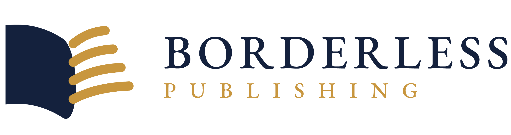

# Borderless Publishing: brand guidelines

Give this page to anyone who designs for Borderless Publishing: cover designers, printers, web designers.

## The idea

An open book. The left page is solid; the right page has no edge, only its lines of text, which run on past where the page would end. Words that cross borders.

## Logo versions

All files are in `logo/`: `svg` for screens and the web, `png` (transparent, high resolution) for documents and social media, `pdf-print` for printers (ink colours, vector).

| Version | Use it for | File name |
| --- | --- | --- |
| Horizontal | Letterhead, website header, email signature | `logo-horizontal` |
| Stacked | Title pages, sell sheets, posters, square spaces | `logo-stacked` |
| Mark | Book spines, social media avatars, small spaces | `mark` |
| Wordmark | Where the mark is already shown nearby | `wordmark` |
| Reversed | On navy or dark photographs (cream lettering, gold lines) | `-reversed` |
| White | On any dark or coloured background where gold would not show | `-white` |
| Black | One colour printing: inside books, spines of black and white books, newspapers | `-black` |

Icons for websites and apps: `png/favicon-32.png`, `png/apple-touch-icon-180.png`, `png/icon-512.png`, `svg/icon.svg`.

## Clear space and size

- Keep a space around the logo at least **half the height of the mark** on every side. Nothing else (text, edge of the page, other logos) goes inside it.
- Smallest sizes: horizontal logo **30 mm** wide in print or **180 px** on screen; stacked logo **20 mm** wide; mark alone **6 mm** high (the size on a book spine) or **24 px**.

## On a book

| Where | What | Size and position |
| --- | --- | --- |
| Spine | `mark-black` (black and white interiors) or `mark` (colour covers) | 6 to 8 mm high, centred across the spine, 10 mm above the foot. Leave it off spines narrower than 6 mm. |
| Title page | `logo-stacked-black` | 22 to 28 mm wide, centred at the foot of the page |
| Back cover | `mark` or `mark-reversed` | 8 to 10 mm high, near the barcode, never inside the barcode's clear area |
| Copyright page | The words "Borderless Publishing" in the text, no logo needed | |

Borderless Studio adds the publisher name to the title page and copyright page by itself; add the spine logo in the cover builder as a picture when you want it.

## Colours

| Name | Screen (HEX) | Screen (RGB) | Print (CMYK, close match) | Use |
| --- | --- | --- | --- | --- |
| Delta navy | #14213D | 20, 33, 61 | 100, 82, 35, 45 | The mark, the wordmark, backgrounds |
| River gold | #C8963E | 200, 150, 62 | 18, 40, 85, 5 | The lines of the mark, "PUBLISHING", accents |
| Paper | #F7F3EA | 247, 243, 234 | 2, 3, 8, 0 | Backgrounds, reversed lettering |
| Ink | #1B1B1B | 27, 27, 27 | 0, 0, 0, 100 for text | Body text |

The print values are close equivalents for coated paper. Printers vary: ask for a printed proof before a large print run, and match the proof to the screen colour by eye.

## Typography

- **EB Garamond** (free, SIL Open Font Licence, bundled with Borderless Studio) for everything printed: the logo lettering, books, letters, the sell sheet, business cards. The logo uses EB Garamond Medium in capitals: "BORDERLESS" spaced at 0.11 em, "PUBLISHING" smaller, in gold, spaced at 0.62 em.
- **Source Sans 3** (free, Open Font Licence) where a plain sans serif is needed: website menus, forms, small labels.
- For Bangla: Noto Serif Bengali or Tiro Bangla.

## Tagline

*Books priced for readers.*

Use it under the logo on banners and cards, in EB Garamond italic.

## Please do not

- Change the colours, except to the black, white and reversed versions provided.
- Stretch, squash, rotate or add effects (shadows, outlines, glows) to the logo.
- Rearrange the mark and the wordmark, or set the wordmark in another typeface.
- Put the colour logo on a busy photograph; use the white version on a dark, calm area instead.
- Recreate the logo by hand: use the files.

## Changing the logo or your details

Everything is made from `source/logo-lib.typ` by `source/make-brand.py`. Your name, email, phone, website and tagline for the business card are in `source/brand-details.json`. After a change, run:

    python3 01-brand/source/make-brand.py

The business card file `stationery/business-card-print.pdf` is 96 x 61 mm: the Australian card size of 90 x 55 mm with 3 mm bleed on each side, as most printers ask. Tell the printer it includes bleed and has no crop marks.
